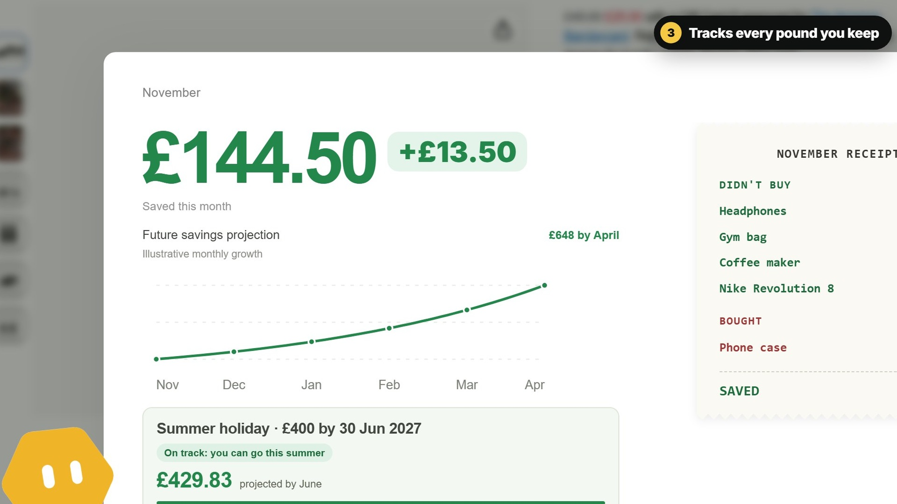
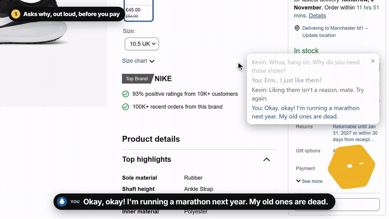

# Resist or Be Broke

  
   
  <b>▶ <a href="docs/media/kevin-demo.mp4">Watch the 1-minute demo</a></b> · real amazon.co.uk, real prices, voice by ElevenLabs

  <b>Buying takes one click. Saving it back takes months.</b> 
  Meet <b>Kevin</b>: he lives in the corner of your browser and asks you, out loud, why you need it before you pay.

  

## What you're seeing

| | Feature | In the demo |
|---|---|---|
| **1** | **Asks why, out loud, before you pay** | You click *Add to basket* on £45 Nike Revolution 8s. "Erm… I just like them?" gets a no. "I'm running a marathon next year" gets a yes. |
| **2** | **Finds the same thing cheaper** | Same Nike Revolution 8 at Sports Direct, **£31.50: £13.50 saved**. *Buy it cheaper* opens it in a new tab; Amazon stays open. |
| **3** | **Tracks every pound you keep** | Hover the bottom-right corner on any site: the dashboard shows **£144.50** saved and a new *Nike Revolution 8* row on the receipt. |
| **4** | **Plans your next goal with you** | "Marathon kit! A hundred and fifty quid, by June." Added by voice. |
| **5** | **Says no when it really matters** | Friday 11pm, a bottle of wine, "I just wanna party with my mates!" Flat no, and the dashboard warns: *"Your whole saving will drop after this, but it's on you!"* |

## About

A Chrome extension for UK students on loans. When you're about to buy something on Amazon, it says back **your own** monthly goals and rules, plus exactly what the purchase does to your money before next payday — and finds a cheaper identical item. It never blocks: **Continue to checkout always works**.

> It's not the AI stopping you. It's you.

**Built with:** Vue 3 + TypeScript Chrome extension (WXT) · Express backend · ElevenLabs Conversational AI (speech-to-speech) · Claude · Firecrawl. Built at GreatUniHack 2026.
